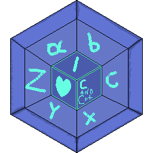
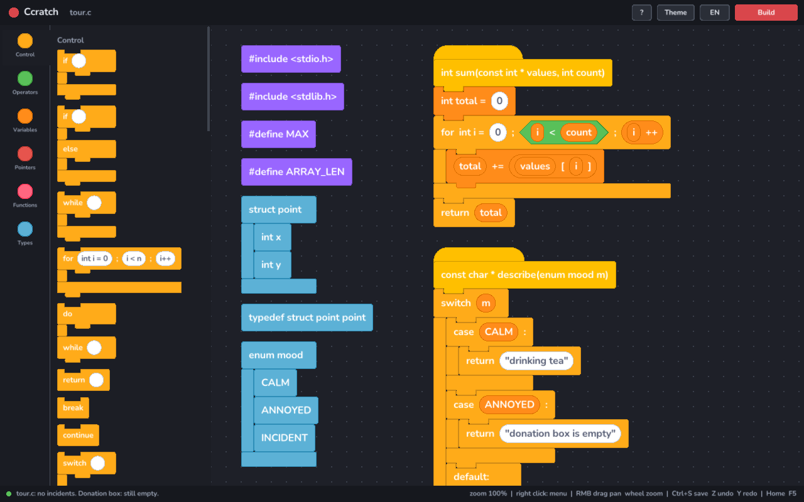
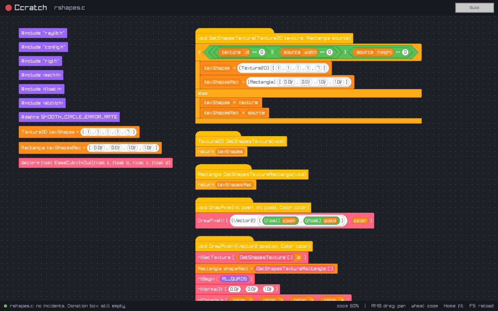
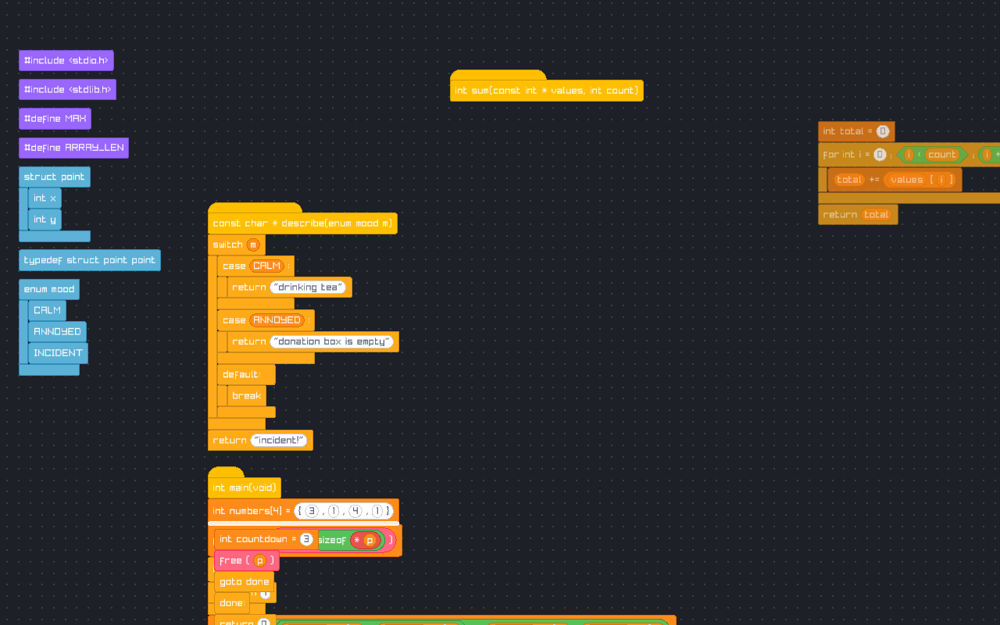

<p align="center"></p>

# Ccratch

Scratch, but for raw C. No ready-made loops, no hand-holding, no Cargo.
You drag `while`, `switch` and `break` around yourself, and the cat can segfault.

> Memory safety as a lifestyle choice.

## Status

- Step 1: a window, a pannable canvas and one lonely block.
- Step 2: libclang reads a `.c` file into Ccratch's own syntax tree.
- Step 3: that tree is drawn as Scratch-style blocks.
- Step 4: blocks can be dragged. Not saved back to the file yet.



Real code works too. This is raylib's own `rshapes.c` (2400 lines):



How the colors map to C:

| Color | What |
| --- | --- |
| Yellow hat | function definition |
| Gold | control flow: `if`, `for`, `while`, `switch`, `return`, `goto` |
| Orange | variables, assignment, `->`, `[]` |
| Green | operators; hexagons are conditions, like in Scratch |
| Red | pointer `*` and `&` (future wires start here) |
| Pink | function calls and declarations |
| Blue | types: `struct`, `enum`, `typedef` |
| Purple | preprocessor: `#include`, `#define`, macro values like `NULL` |
| White | literals |
| Grey | "here be dragons": no block for this yet, raw code shown |

Dragging works like Scratch:

- grab a statement and it comes with everything under it in its stack;
- grab a function hat, a struct or an `#include` and the whole thing moves;
- drop a stack near the white bar and it joins that stack, or into an
  empty `if`/`while`/`for` mouth;
- drop it anywhere else and it lies loose on the canvas, faded.
  **Loose blocks are not part of the program**: dragging a block out is
  how you remove it from the code.

Every move edits the syntax tree itself, so what you see is what will be
written back once saving lands.



Object-like macros used as values (`NULL`, `true`, `DEG2RAD`) stay one
purple block. Function-like macros (`MAX(a, b)`) are shown expanded,
since their arguments are real code.

`--dump-ast` prints the tree the blocks are built from:

```
$ ccratch --dump-ast examples/tour.c
...
      ├─ Call free  [63:5]
      │  └─ Ref p  [63:10]
      ├─ Goto done  [64:5]
      └─ Label done  [65:1]
```

## Layout

```
app/        ccratch      - the launcher: main() calls ccr_run(), that's it
ccratch/    libccratch   - the whole IDE in one library (modular monolith)
  ccr_ast     own syntax tree: flat node array + string arena, no libclang
  ccr_parse   the only code that knows libclang exists
  ccr_blocks  one script -> blocks: flat display list + snap points
  ccr_editor  scripts on the canvas, drag and drop, edits the tree
gui/        libccr_gui   - the only code that knows raylib exists
include/    public headers: ccratch.h, ccr_plugin.h (plugin ABI)
plugins/    each plugin is its own .so; hello/ is the template
examples/   C files to feed the parser
docs/       screenshots
tests/      headless CTest suite
cmake/      dependencies, fetched from git by tag; FindLibClang
```

## Build

Needs GCC (or Clang), CMake 3.21+, libclang, and the X11/OpenGL dev headers
raylib uses. On Fedora:

```sh
sudo dnf install gcc cmake clang-devel libX11-devel libXrandr-devel \
                 libXinerama-devel libXcursor-devel libXi-devel mesa-libGL-devel
```

If libclang lives somewhere unusual, pass `-DLIBCLANG_ROOT=/path/to/llvm`.

Then:

```sh
cmake --preset debug      # or: release, paranoid
cmake --build --preset debug -j
./build/debug/bin/ccratch
```

Presets use Unix Makefiles. Ninja is not invited.

`paranoid` turns on `-Werror`, AddressSanitizer and UBSan for our code.

Tests run without a window:

```sh
ctest --test-dir build/debug --output-on-failure
```

### If CMake complains about a different directory

`build/` remembers absolute paths. After moving or renaming the project
folder, delete it and configure again:

```sh
rm -rf build && cmake --preset debug
```

### If parsing complains about `stddef.h` or `size_t`

libclang could not find clang's own builtin headers. Ccratch looks for
them at run time next to the libclang it loaded (this covers Fedora, where
libclang is in `/usr/lib64` and the headers in `/usr/lib/clang/N`), then
falls back to the path found at build time. See what it picked:

```sh
ccratch --about
```

Override it with `CCRATCH_CLANG_RESOURCE_DIR=/usr/lib/clang/22`, or per
file with `ccratch file.c -- -resource-dir ...`.

## Command line

```
ccratch                                  open the editor
ccratch file.c                           open a file as blocks
ccratch file.c -- -Iinclude -DDEBUG      extra arguments go to clang
ccratch --dump-ast file.c                print the syntax tree, no window
ccratch file.c --zoom 50                 start zoomed out
```

`--dump-ast` exits with 0 if the file is clean, 1 if it has errors,
2 if clang could not read it at all.

## Controls

- Drop a `.c` file onto the window: open it
- Left mouse drag: move blocks
- Right or middle mouse drag: pan the canvas
- Mouse wheel: zoom around the cursor
- Home: back to the start of the file at 100%
- F5: reload the file from disk (throws away unsaved moves)
