<p align="center"></p>

# Ccratch

Scratch, but for raw C. No ready-made loops, no hand-holding, no Cargo.
You drag `while`, `switch` and `break` around yourself, and the cat can segfault.

> Memory safety as a lifestyle choice.

## Status

- Step 1: a window, a pannable canvas and one lonely block.
- Step 2: libclang reads a `.c` file into Ccratch's own syntax tree.
- Step 3: that tree is drawn as Scratch-style blocks.
- Step 4: blocks can be dragged.
- Step 5: Ctrl+S writes the moves back to the `.c` file.
- Step 6: Ctrl+Z / Ctrl+Y undo and redo.
- Step 7: a palette of new blocks, so you can write code, not only move it.
- Step 8: a Blender-style pie menu, plus delete, duplicate and comment out.
- Step 9: the interface speaks other languages, from packs you drop in a folder.
- Step 10: expressions come out of their slots and go into other ones.
- Step 11: every `goto` has an arrow to its label.
- Step 12: themes, as files, and four of them to start with.
- Step 13: the palette grows up: six categories, operators, variables, pointers, switch, casts.
- Step 14: goto arrows you can travel along, operators you can swap, several files open at once.
- Step 15: whole files from blocks: functions, structs, headers with guards, new files and folders.
- Step 16: folding, and libraries as blocks from YAML packs (raylib to start with).
- Step 17: any library made into blocks from inside Ccratch: its headers read for the API, its .so/.a for the ABI.
- Step 18: CMake as blocks: CMakeLists.txt opened, edited and saved like C, or made for a project that has none.
- Step 19: the Build button: CMake builds in the background, the program runs, errors land on their blocks.
- Step 20: getting around: tabs, find (Ctrl+F), palette search, green flag, F1, recent files, no lost work on quit.
- Step 21: copy and paste blocks between files (and any C as blocks), selection, minimap, autosave, panels you can size.
- Step 22: Git as cards, block explanations, fourteen languages in human words, a settings window, Bug hunt builds.
- Step 23: plugins, for real, and the first official one: Code Hater.
- Step 24: C++ as blocks (namespaces, classes, methods, range-for, new/delete), C / C++ over the palette, the standard library in a section of its own.
- Step 25: commits made together: co-authors on the cards, the badges and the history, and picked when committing.
- Step 26: C and C++ as the palette's catalogue tabs, in each theme's colours, with the standard library's switch beside them.
- Step 27: search and replace across the project, as VS Code's (text, or names as the compiler sees them); blocks put anywhere and kept there, arranged as columns, a newspaper or by calls.
- Step 28: arrangements of your own (a builder, and files to write by hand), one of them for files opening for the first time; Code Hater reads context.
- Step 29: assembly as blocks: `.s`/`.S`/`.asm` files (GNU as, AT&T or Intel, and NASM) and `asm()` inside C; plugins with settings of their own; Code Hater learns assembly, a hundred new ways to say it, and a mother cat who rubs your nose in the bug.
- Step 30: ARM assembly too: 64-bit (AArch64: phones, Apple M chips, Raspberry Pi 4/5) and 32-bit ARM/Thumb, told from x86 by what the file says; Code Hater learns ARM's ways back (`bl` and the link register).


Real code works too. This is raylib's own `rshapes.c` (2400 lines):


How the colors map to C:

| Color | What |
| --- | --- |
| Yellow hat | function definition |
| Gold | control flow: `if`, `for`, `while`, `switch`, `return`, `goto` |
| Orange | variables, assignment, `->`, `[]` |
| Green | operators; hexagons are conditions, like in Scratch |
| Red | pointer `*` and `&` (future wires start here) |
| Pink | function calls and declarations |
| Blue | types: `struct`, `enum`, `typedef` |
| Purple | preprocessor: `#include`, `#define`, macro values like `NULL` |
| White | literals |
| Grey | "here be dragons": no block for this yet, raw code shown |

Blocks fit together like a puzzle, as in Scratch: a notch on top of each
statement, a tab under it, so you can see where one ends and the next one
starts. `return`, `break`, `continue` and `goto` have flat bottoms:
nothing after them runs, and the shape says so.

Dragging works like Scratch:

- grab a statement and it comes with everything under it in its stack;
- grab a function hat, a struct or an `#include` and the whole thing moves;
- drop a stack near the white bar and it joins that stack, or into an
  empty `if`/`while`/`for` mouth;
- drop it anywhere else and it lies loose on the canvas, faded.
  **Loose blocks are not part of the program**: dragging a block out is
  how you remove it from the code.

Every move edits the syntax tree itself, and Ctrl+S writes it back.

## Writing new code

The palette on the left is Scratch's: a strip of coloured dots, one per
category (click one and the list glides to it, or scroll with the wheel),
and next to it every block, drawn as the real thing:

| Category | Blocks |
| --- | --- |
| **Control** | `if`, `if / else`, `while`, `for`, `do / while`, `return`, `break`, `continue`, `switch`, `case`, `default`, `goto`, a label |
| **Operators** | `+ - * / %`, `< > <= >= == !=`, `&& \|\| !`, `& \| ^ ~ << >>`, `c ? a : b` |
| **Variables** | `int x = 0`, `int x`, `=`, `+=`, `-=`, `*=`, `++`, `--` |
| **Pointers** | `&a`, `*p`, `a[i]`, `s.field`, `p->field`, `NULL` |
| **Functions** | a **code line** for anything else, `f(...)` as a statement and as a reporter |
| **Types** | `(int) a`, `sizeof(int)`, `sizeof a` |
| **File** | a function (a hat to stack its body under), a prototype, `struct` (declarations go in its mouth), `enum`, `typedef`, a global, `#include <...>`, `#include "..."`, `#define` |
| **Standard library** | `printf`, `puts`, `scanf`, `fgets`, `malloc`, `calloc`, `realloc`, `free`, `strlen`, `strcmp`, `memcpy`, `memset`, `rand`, `srand`, `sqrt`, `pow`, `fopen`, `fprintf`, `fclose`, `exit` (C++: below) |

### The standard library, on its own

The language itself (`if`, `for`, pointers, structs...) and its standard
library are two different things, and the palette keeps them apart: the
library's blocks are a section of their own at the bottom, teal, like
the library they are; your own functions stay pink. Drop `printf` into a
file and `#include <stdio.h>` comes along by itself (`strlen` brings
`<string.h>`, `std::sort` `<algorithm>`...).

**std** beside the C / C++ tabs (or **Settings > Editor > Standard
library blocks**) off, struck out: the section is gone,
and what is left is C itself and your own functions. For writing a
kernel, a bootloader, firmware, or just to see how much is the language
and how much is libc.

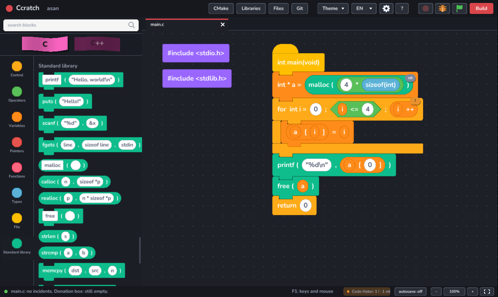

### What is this block for?

Rest the mouse on a block in the palette for half a second and a card
slides out beside it: what the block does, how to use it in Ccratch
(which slot wants what, what goes in its mouth), and a few lines of C
that use it. A block from a library pack or from the project shows its
C signature, its comment and the header it comes from.


The words are in `lang/CODE.explain`, plain enough for someone who has
never programmed. English and Russian say something for every block;
any other language falls back to English for what it leaves out, and
`CODE-plain.explain` can say it plainer still:

```
for.what = Repeats a set number of times, counting as it goes.
for.how  = Three slots: where the counter starts, until when, how it steps.
```

`ccratch --check-explain lang/fi.explain` finds unknown blocks and broken
lines (`--complete`: and the blocks it says nothing about yet).
**Settings > Editor > Block explanations** (or `explain = off` in `~/.config/ccratch/config`) turns the cards off.

Blocks from **File** are the file's own: let one go anywhere on the canvas
and it joins the file where C wants it, after the last one of its kind:
`#include`s, then `#define`s, types, prototypes, globals, functions. In a
header that is inside its guard, before the `#endif`. On the canvas it
stays where you dropped it. Made by mistake? Delete it, or throw it back
onto the palette.

Statements snap into stacks; the rounded and pointy ones are reporters
and go into slots, like Scratch's. Drag one out and it behaves like any
block: old statements can be dropped into new ones and the other way
round.

Round white slots take a reporter, or text: click one, type, Enter keeps
it, Esc throws it away, Ctrl+V pastes. A reporter dropped on a slot that
has text in it replaces the text. Square white fields are names and types
(the `x` and `int` of `int x = 0`, the `f` of `f(...)`, a label's name):
typed into, never dropped into. A fresh `goto` and a fresh label are both
`done`, so a new pair is already an arrow. Each edit is one undo step.

Drop a block back onto the palette to delete it (Ctrl+Z brings it back).
That works for statements from the file too.

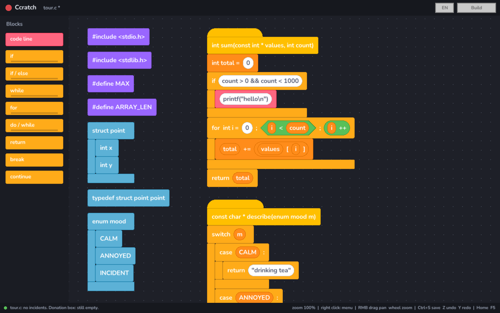

New blocks have no text in the file, so saving prints them; everything
around them is still copied as written:

```c
    if (count > 0 && count < 1000) {
        // a comment that moved in with its statement
        printf("hello\n");
        n = 100;
    }
```

Parentheses are added only where C needs them: `+` dropped into the
right side of `-` saves as `total - (n + b)`, `*` into `+` as
`n * 2 + 1`, and `!` around `n == 3` as `!(n == 3)`. That goes for text
typed into a slot too, and for expressions moved out of the file into new
places.

### Changing an operator

Click an operator (`+`, `==`, `+=`, `++`, `!`...) and the others of its kind
drop down: arithmetic, comparisons and `&&`/`||`, bits, assignments,
prefix, `++`/`--`. It works on code from the file too: the expression
is printed anew around its operands' own text, with parentheses where the
new operator binds differently. `a + b + pr.x + pr.y` with the first `+`
made `*` and the last one too saves as `(a * b + pr.x) * pr.y`, the same
tree you see. Operators that come out of a macro are not offered. Each
swap is one undo step.

### Folding

Double click an `if`, a loop, a `switch`, a function or a struct (or use
the pie's south-west slice over it) and it folds to one line with a count
of what it hides: `if (n > 3) { 4 }`, `int load(const char *path) { 14 }`.
Double click again to unfold. Folding is how you look at the code, not
a change to it: it never reaches the file and is no undo step. A `goto`
arrow into a folded block points at the fold, and travelling along it
unfolds what is in the way.

## C++

Over the palette, as the dividers of a card catalogue, two tabs: **C**
and **C++**. The one in front is the section the palette shows, and runs
on into it; a click on the one behind brings it forward (and each is
left scrolled where it was). A `.cpp` (`.cc`, `.hpp`...) file brings C++
forward by itself, a `.h` keeps what was picked. The open file's
language has the file's name under its tab. C++ in front over a C file
gets a red **!**: its blocks will not compile there, and one dropped in
anyway says so in the status bar (C's blocks in a C++ file mostly do
compile, so they say nothing). In a CMake file there is one tab, CMake.
The colours are the theme's: `lang_c`, `lang_cpp`, `lang_cmake`.

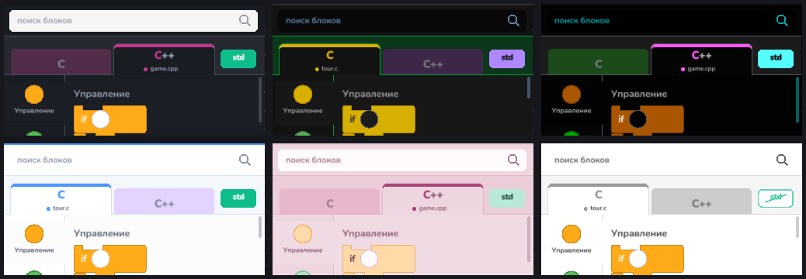

C++'s palette has what C's has, plus:

| Section | C++ blocks |
| --- | --- |
| **Control** | `for (auto x : v)` |
| **Pointers** | `nullptr` (instead of `NULL`), `new T(...)`, `delete p` |
| **Types** | `static_cast<T>(a)` |
| **Classes** | `class` (members go in its mouth), a method, `public:`, `private:`, `this` |
| **File** | `namespace` (declarations go in its mouth), `using namespace std;` |
| **Standard library** | `std::cout << ...`, `std::cin >> x`, `std::string`, `std::vector<int>`, `v.push_back(x)`, `v.size()`, `std::sort`, `std::getline`, `std::to_string` |

A C++ file reads as what was written, not as what the compiler made of
it: a namespace is a purple C-block holding what is in it, a class a
blue one holding its fields, `public:`/`private:` and methods; a method
is a yellow C-block whose body takes blocks like any function's.
`std::cout << a << b` is a chain of `<<` blocks (not calls to
`operator<<`), `team.push_back(x)` shows its object, `for (auto &p : team)`
is a loop, `new` and `delete` are pointer-red, and the constructors the
compiler adds by itself (a `std::string` made from `"text"`) are not
there at all. Heads say what they say in the file: `template <typename T>`,
`const`, a constructor's `: name_(name)`.

A method or a field from the palette can be dropped straight into a
class (or anything into a namespace) that is already in the file: it is
saved on a line of its own there, indented like the members around it.
What was dropped in can be taken out again; the members the file already
had stay where they are. Lambdas and `try`/`catch` are still grey
dragons: shown as written, saved as they were.

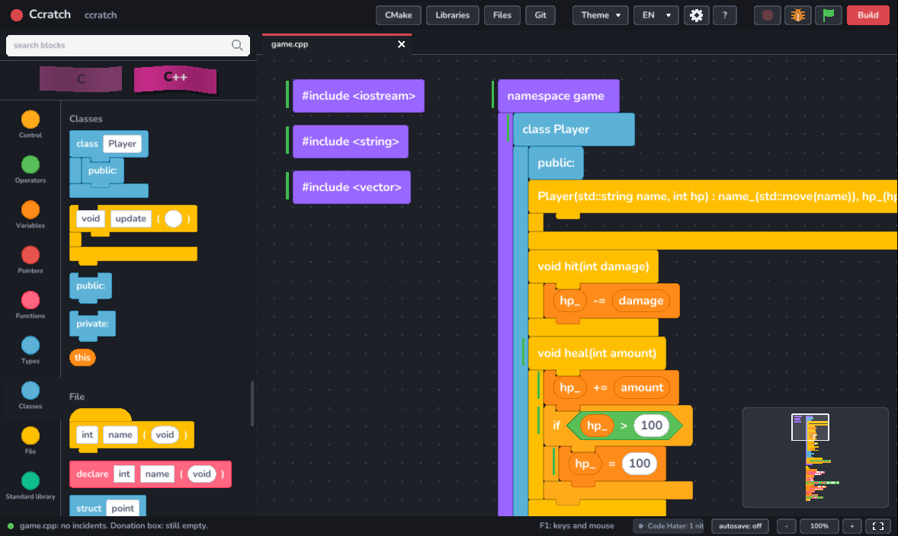

## Libraries as blocks

A block pack turns a library's functions into blocks that read like
Scratch. It is a YAML file in `blocks/` (or `~/.local/share/ccratch/blocks/`,
or `$CCRATCH_BLOCKS_DIR`):

```yaml
name: raylib
header: raylib.h            # the pack shows when a file includes it
color: library              # a theme category: library, call, control...
blocks:
  - call: InitWindow
    text: open a window {width} x {height} called {title}
    text.ru: открыть окно {width} x {height} с названием {title}
    params: [width, height, title]
    defaults: {width: 800, height: 450, title: '"Hello, raylib!"'}
  - call: WindowShouldClose
    text: the window wants to close
    returns: bool           # not void: a reporter; bool: a pointy one
  - call: IsKeyDown
    text: key {key} is down
    params: [key]
    choices: {key: KeyboardKey}   # this slot picks from a list
choices: {color: Color}     # every slot called color, in every block
enums:
  KeyboardKey: [KEY_SPACE, KEY_ENTER, KEY_UP, KEY_DOWN]
  Color: [LIGHTGRAY, RED, GREEN, BLUE, RAYWHITE]
```

`{name}` in the text is that parameter's slot; `text.ru` and friends are
the text in other interface languages. When the file includes the
header, the pack gets its own section in the palette. And code that is
already there reads the same way: a call with a pack's name and number
of arguments is drawn as its block. Saving writes it as the plain C call
it always was.

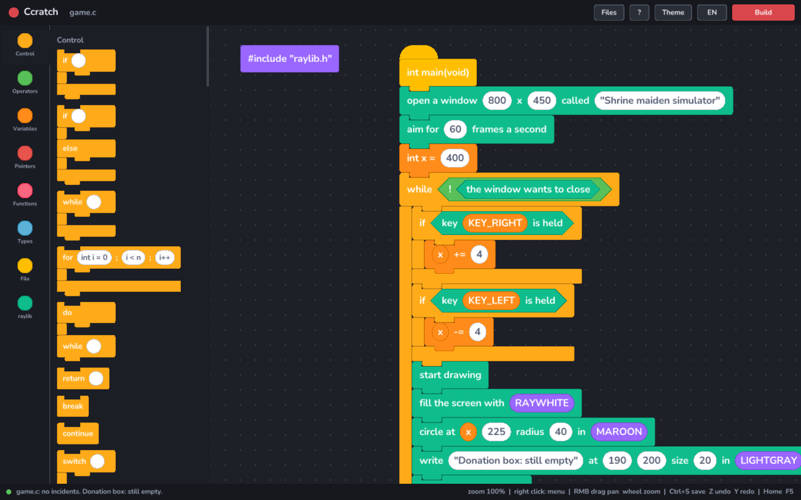

### The project's own functions

Every function the project's files declare (not `static`, not `main`)
is a block too, in the palette's **This project** section, for every file
of the project: `add ( a , b )`, as its call reads. Ccratch reads the
project's `.c` and `.h` with clang in the background (bodies skipped,
`build/` and hidden folders left alone) and again after a save; a file
that did not change is not read twice. A function a header declares
brings that header along: dropped into `main.c`, `paint` adds
`#include "util.h"`. And the header's enums give its slots their lists,
from any file.

### Slots with a list

A slot that takes one of a few values has a little ▾: a click drops a
list down, typing narrows it (`re` leaves RED, GREEN, DARKGREEN), the
arrow keys and Enter pick, and so does the mouse. The lists come from:

- the pack: a block's `choices`, the pack's `choices` by slot name, or
  the enum its C type names (drafted packs write `types:` and `enums:`);
- the file's own enums, wherever one is expected: an argument of the
  file's function that takes `enum dir`, the other side of `d == DOWN`
  or `d = LEFT`, `enum dir d = UP`, a `case` in a `switch` over one, the
  `return` of a function that gives one back; typedefs are followed;
- `bool`: true and false.

A name or number read from the file gets the list as well: picking
another value puts it in that slot, one undo step.

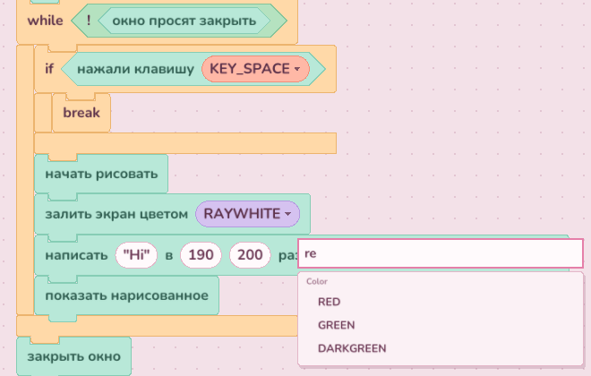

A raylib pack with what a first game needs ships with Ccratch. Any other
library becomes blocks from inside Ccratch: **Libraries** in the top bar.
It lists the headers the file includes that have no blocks yet, the
packs it could include, and takes any header by name or path
(`SDL2/SDL.h`, `zlib.h`, `zlib`, `../vendor/foo.h`). Then:

1. **The API.** clang reads the header, and the headers next to it that
   it pulls in, for the public functions: their parameters and types,
   `bool` returns (pointy blocks), `...` (one slot for the rest), and the
   enums, written down for the slots that take them. Names starting with
   `_` are not public; a header right in `/usr/include` keeps to itself,
   not the libc around it.
2. **The ABI.** If the library's binary is found (`libNAME.so` or
   `libNAME.a`, in the project or the system's lib folders), only what
   it really exports stays: a declaration the binary does not have would
   not link. `static inline` helpers in the header need no binary and stay.
   The pack remembers what to link with (`link: z`).
3. **The pack** is written as YAML with texts made from the names
   (`deflateSetDictionary(strm, dictionary, dictLength)` reads "deflate
   set dictionary {strm} dictionary {dictionary} dict length
   {dictLength}"): into `PROJECT/.ccratch/blocks/` for the project's own
   library, `~/.local/share/ccratch/blocks/` for the system's. A pack that
   is there already is kept, edits and all.
4. **The file includes it** (`#include <zlib.h>` for system headers, the
   path from the project for its own), one undo step, and the blocks show
   in the palette. Calls already in the code turn into the new blocks.
   A library block dropped into a file that lacks its header brings the
   `#include` along.

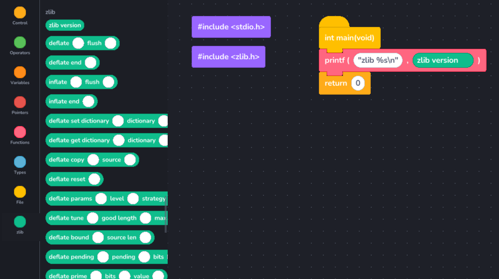

A library can also choose its blocks itself, the way Qt's moc reads
`signals:` from a header. Once any function has `@block` in its doc
comment, only those become blocks, with those words:

```c
/// @block beep {times} times
/// @block.ru пискнуть {times} раз
void beeper_beep(int times);
```

The same from the command line, and the draft is a start to edit:

```
ccratch --make-blocks path/to/lib.h -- -Ipath/to > blocks/lib.yaml
ccratch --check-blocks blocks/lib.yaml
ccratch --list-blocks
```

YAML because packs are written by hand: comments, no quotes around every
word, no commas to forget. Ccratch reads the part of YAML packs need
itself, no library pulled in for it.

## CMake as blocks

Building comes in two steps: what to build (CMake), then building it.
Ccratch does the first with blocks too. `CMakeLists.txt` and `*.cmake`
open like any C file, read by Ccratch's own CMake reader (no clang
involved): a hat with the file's name, a command per block, arguments as
slots, `PRIVATE`, `REQUIRED`, `VERSION` and the like as words. `if()` /
`elseif()` / `else()` are C-shaped blocks, and so are `foreach`, `while`,
`function`, `macro` and `block`. Saving works as for C: text nobody
touched is copied byte for byte (comments, a long `add_executable` broken
over lines), what changed is written in the file's own indentation. The
tests read, save and rebuild every module of the CMake installed, a good
thousand files.

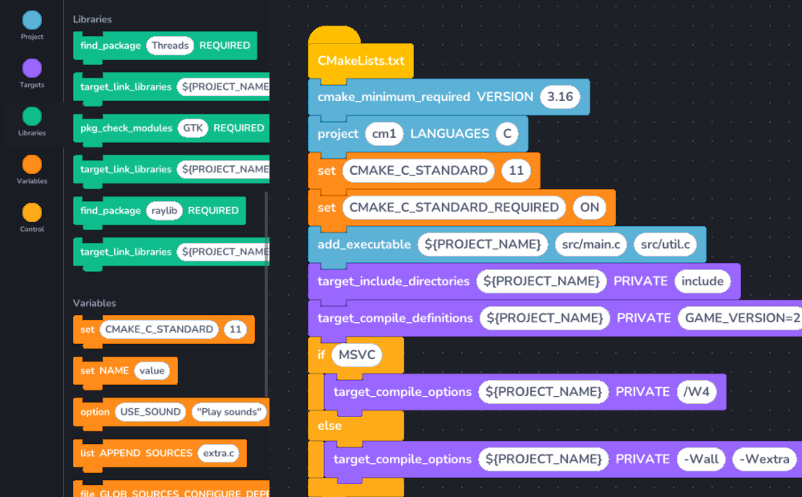

The palette follows the file on screen: C's blocks for C, and for CMake
**Project** (`project`, `add_executable`, `add_library`...), **Targets**
(include folders, options, definitions, linking), **Libraries**,
**Variables** and **Control**. Libraries has a `find_package` and a
`target_link_libraries` for every block pack that says how its library
is linked (`link: z`, `find_package: raylib REQUIRED` in the pack).

The **CMake** button in the top bar opens the project's `CMakeLists.txt`.
If there is none, it makes one first, from what is there:

- every `.c` file goes into one program (a second `main()` is left out);
- `include/` is searched for headers;
- what the code includes decides what is linked: packs' `link:` and
  `find_package:`, `math.h` brings `libm`, `pthread.h` brings threads;
- warnings on, for GCC/Clang and for MSVC alike.

It is plain CMake: `ccratch --make-cmake DIR` prints the same for a
look first, and `cmake -S . -B build && cmake --build build` builds it.

## Assembly as blocks

Under C there is always the machine, and Ccratch opens that too. A `.s`,
`.S` or `.asm` file is read by Ccratch's own assembly reader (no clang,
no assembler needed), in the syntax it is written in: GNU as with AT&T
operands (what gcc writes), GNU as after `.intel_syntax`, or NASM.

- every **global label** (`.globl main`, `global _start`) gets a hat:
  that is where code starts running, so that is where a stack starts;
  every **section** (`.data`, `section .rodata`) gets one of its own, on
  the left, code on the right;
- an **instruction** is a block, its mnemonic and then each operand a
  slot: `movl [$1] , [%ebx]`; coloured by what it does: moving data
  orange, arithmetic and compares green, jumps and calls gold,
  directives purple, data blue;
- a **local label** is a block of its own, and every **jump** to it
  (`jne .L3`, `loop`, `jmp`) has an arrow to it, as `goto` does in C.
  `jmp` and `ret` have flat bottoms: nothing after them runs; `jne`
  does not, the code goes on when it does not jump;
- `.macro`/`.endm`, `.rept`, `%macro`, `%rep` are C-shaped blocks with
  their end written under the mouth, `.if`/`.else`/`.endif`, `%ifdef` and
  `#ifdef` in a `.S` file too;
- `msg db "hi", 10` and `len equ $ - msg` keep their label with them;
- saving works as for C and CMake: nothing touched, nothing changed, byte
  for byte; a moved instruction keeps its own spacing and comment. The
  tests read gcc's own assembly of this project and of raylib (AT&T and
  Intel), save it with every block rebuilt, assemble both and compare the
  bytes.

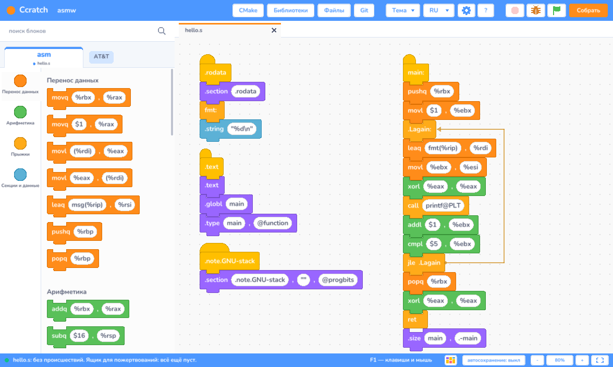

The palette follows the file, and speaks its syntax (the pill beside the
tab says which): **Moving data** (`mov`, `lea`, `push`, `pop`, loads and
stores), **Arithmetic** (`add`, `sub`, `imul`, `xor`, shifts, `cmp`,
`test`), **Jumps** (a label, `jmp`, `je`, `jne`, `jl`, `jg`, `call`,
`ret`, `syscall`) and **Sections and data** (`.globl`, `.text`, `.data`,
`.string`, `.quad`, `.byte`, a macro, a repeat). The same block is
`movq %rbx, %rax` in an AT&T file and `mov rax, rbx` in NASM. **+ file**
makes a `.s` or an `.asm` that already assembles; the Build button builds
GNU assembly with the C files (`project(... LANGUAGES C ASM)`), and a
`main:` in one is the program's `main` (NASM wants its own assembler, so
an `.asm` is left out, with a note in the CMakeLists).

### ARM

The same `.s` can be for a PC or for a phone, and the file does not say
which in its name: Ccratch reads the registers and mnemonics in it and
takes the vote (`%rax` and `movq` for x86; `x0`, `adrp`, `stp` for 64-bit
ARM; `r4`, `push {r4, lr}`, `bx lr` for 32-bit ARM and Thumb). The pill
beside the tab says what it decided: **AArch64** or **ARM**.

- `#1` is a number there, not a comment (a `#` comments only at the start
  of a line); comments are `//` on AArch64 and `@` on 32-bit ARM;
- `b`, `b.eq`, `bne`, `cbz x0, .L2`, `tbnz w1, #3, .L5` are jumps with
  arrows (what `cbz` tests stays a slot on its block); `bl` is a call;
  `b`, `ret`, `bx lr`, `pop {r4, pc}` have flat bottoms;
- `stp x29, x30, [sp, #-16]!` and `push {r4, lr}` keep their brackets and
  braces as one operand each;
- the palette speaks it: `mov x0, #1`, `ldr`/`str`, `stp`/`ldp`, `adr`,
  `b.eq`, `bl`, `ret` and `svc #0` on AArch64; `push {r4, lr}`, `bx lr`
  on 32-bit ARM;
- `asm("...")` in C written for ARM is read as ARM.

The tests have clang write the same C for AArch64, ARM and Thumb (clang
can, for any machine, with no cross compiler installed), read it, save
it untouched and rebuilt and with every instruction printed anew, then
have clang assemble both and compare the bytes. The Build button builds
the assembly for the machine it runs on and leaves the rest out with a
note in the CMakeLists (an ARM file on a PC needs a cross compiler, or a
Raspberry Pi).

![examples/hello_arm64.s as blocks: stp x29, x30, [sp, #-32]!, adrp and add :lo12:, bl printf, b.le .Lagain with its arrow back to the label](docs/asm_arm.png)

### asm() in C

`asm volatile("..." : outputs : inputs : clobbers)` is a purple block with
a mouth: the string is taken apart into its instructions, one block each,
and the operands go under it, `out: "=r" (sum)  in: "r" (a)`, the
expressions as real slots. Drag instructions in, out, around: saving
writes the string again the way it was written (one string per line with
`\n\t`, or all on one). An instruction dragged out among the C blocks
saves as an `__asm__ volatile("...")` of its own. The C palette has an
**Assembly** section: the `asm` block (with slots for outputs, inputs and
clobbers) and a few instructions, in AT&T as gcc wants it; only assembly
goes into an `asm` block's mouth.

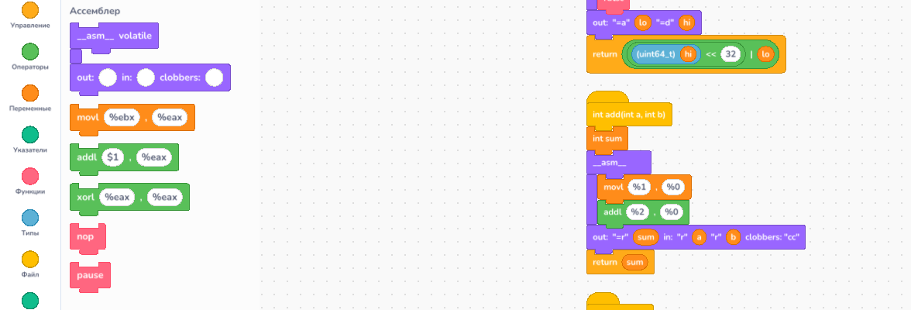

## Getting around

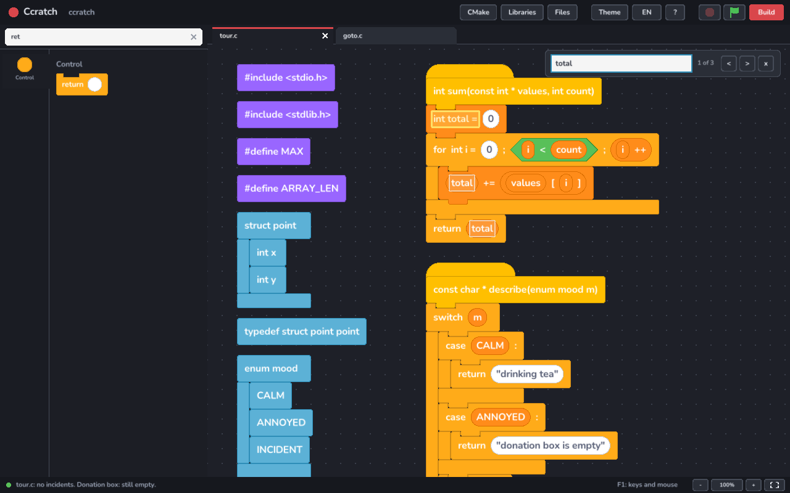

- **Tabs** over the canvas, one per open file, in the order they were
  opened: a click goes there, the x or a middle click closes it. A file
  with changes has a dot; closing it asks for a second click.
  `ccratch a.c b.c` opens both.
- **Find** (Ctrl+F): every word on the canvas that has it lights up,
  `1 of 12`; Enter, F3 and the arrows go from one to the next (Shift:
  back), gliding there. Names inside folded blocks are found too, and
  going to one unfolds it. Any case, Cyrillic included.
- **Palette search**, at the top of the palette: only the blocks that
  say what you typed, from every block pack, not only the included ones.
  Drop a library's block into the file and its `#include` comes along.
- **The green flag** builds and runs, **the stop sign** stops, like
  Scratch. Buttons are in three groups: the project (CMake, Libraries,
  Files), how Ccratch looks (Theme, language, ?), and making the program go.
- **Zoom** at the bottom right: - 100% + and "all of it"; Ctrl+= / Ctrl+-
  / Ctrl+0 too.
- **To where it is made** (F12, or Ctrl+click on a name): a call, a
  variable, a type, in whatever file of the project; the file opens and
  the view glides to the block. Standing on the definition already, it
  lists where it is used instead. **Alt+Left / Alt+Right**: back and
  forward, as in a browser.
- **Where it is used** (Shift+F12): a list at the top right of every
  place in the project that names it, marked made here / declared /
  used, with its line of code; a click goes there.
- **A call under the mouse** tells what it is after a moment: its
  signature, the comment above it, and where it comes from (this file,
  `"util.h"`, a library).
- **Rename** (F2) the name under the mouse in every file of the project:
  a function, a global, a type, an enum's value, a field. clang says
  which thing it is, so a local of the same name elsewhere stays as it
  is. The old name comes selected: type the new one, Enter. One Ctrl+Z
  puts every file back.
- **F1** (or ?): every key and mouse move on one card.
- **Recent files** on the start screen.
- **Quitting** with changes not saved asks: save and quit, quit
  anyway, or stay.
- **Copy and paste** (Ctrl+C, Ctrl+V): the block under the mouse, or a
  selection, goes to the clipboard as C, and C from the clipboard comes
  back as blocks: from another file, a browser, a chat. It is read as if
  it were at the end of the file it goes into, so the file's own types and
  functions are known; a whole function goes straight into the file, one
  expression into a slot. What clang still cannot read there (a variable
  of the function it was copied from) is kept as code lines, never lost.
  The text of a paste lives after the file's own in memory, so it saves
  byte for byte the way it was written.
- **Selection**: drag on empty canvas for a rectangle, Ctrl+A for all;
  Del deletes them all (one undo), Ctrl+C copies them, Esc lets go.
- **Minimap** at the bottom right when the file is bigger than the
  screen: every block in its colour, the screen's part outlined; click or
  drag in it to go there. Ctrl+M hides it.
- **Autosave**, the switch next to the zoom: on, a file saves itself a
  moment after each change.
- **Panels you can size**: drag the edge of the palette, the files
  panel or the build log; Ctrl+wheel over the palette makes its blocks
  bigger or smaller. Remembered for next time.

## Search and replace

The right panel's third tab, **Search** (Ctrl+Shift+F; Ctrl+Shift+H
with Replace open), works as VS Code's: every match in every file of the
project as you type, under its file, with its line, the match lit up. A
click goes there: the file opens, the view glides to the block. Enter
goes from one to the next.

**Text** finds the words wherever a file says them, and you can narrow
it: **everywhere**, **code**, **strings** or **comments**; **Aa** the
case matters, **ab** whole words only; **whole project** or **this
file**. A dot in front of a line says it is in a string or a comment.

The **>** opens **Replace with**. Every line then shows what it will
become: the old text struck out, the new one after it. Replace one line
(the a→b on it), a whole file (on its name), or **Replace all**; x
leaves a line out. **AB** keeps the case: `Hello` becomes `Hi`, `HELLO`
becomes `HI`, `hello` becomes `hi` (Latin and Cyrillic). Put a quote into
a string and it is escaped, so the string still ends where it did. Open
files are searched as they are on screen; replacing saves them first,
writes every file, reads the open ones again, and one Ctrl+Z puts every
file back.

**Names** asks the compiler instead (Enter: clang reads the project).
`count` is then not a word but every thing called that, each on its own,
the way clang tells them apart: the local `count` of `main()`, the field
`count` of `struct guest`, the parameter `count` of `sum()`... each with
its places (green: made there, purple: declared, blue: used). **Rename
to** renames one of them (the a→b on its row) or all of the project's at
once; `count_hellos` and the word "count" in a comment stay as they are.
Things from outside the project (`printf`, a library's) are shown, and
not renamed.

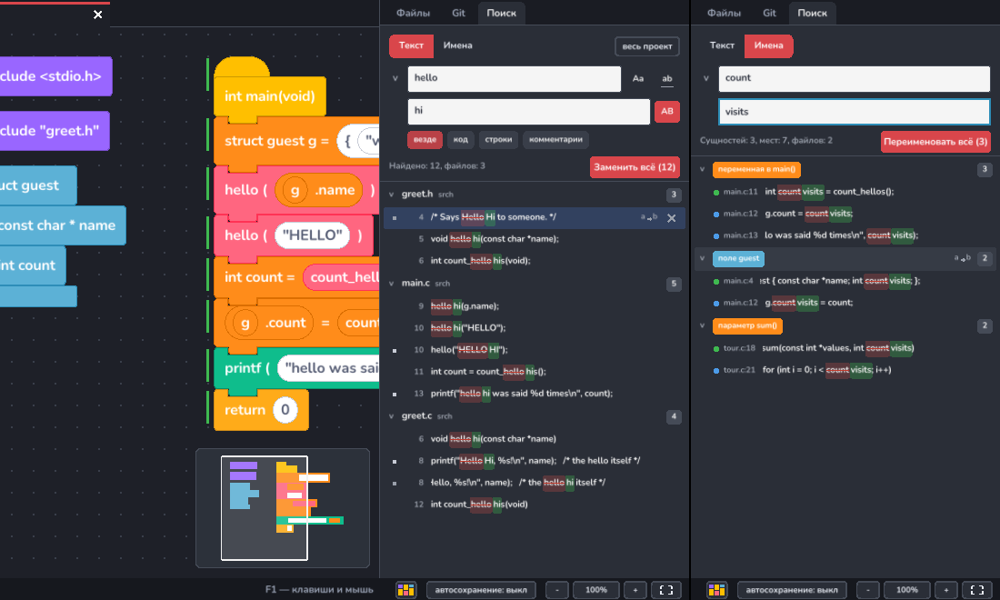

## Arranging the blocks

The blocks do not have to go strictly down the page. Drag a function, a
struct, an `#include` anywhere on the canvas and it stays there. On the
way it lines up with its neighbours: a dashed guide shows when its left
edge (or right) is level with another's, or its top, or it is right
under one. Put it down on other blocks and they make room: the ones it
covers move down out of its way, and nothing ends up on top of anything.
Where everything is is kept beside the file (in
`~/.local/share/ccratch/layout/`, not in your project) and is there again
the next time it opens; stacks that are new in the file go under the
others.

Or arrange the whole file at once with the button left of autosave:

- **Columns**: as a file opens, `#include`s and types on the left,
  functions on the right;
- **Newspaper**: in the file's order, down a column and on in the next,
  as many columns as make it about as wide as the screen;
- **By calls**: `main` (and whatever nobody here calls) on the left, what
  it calls in the next column beside it, what that calls in the next...

The stacks glide to their new places, and one Ctrl+Z puts them back.

### Arrangements of your own

**+ An arrangement of your own...** in the same menu opens a builder:
columns, left to right; in each, ticks for what it takes (`#include`,
`#define`, types, globals, function declarations, `main`, the other
functions, classes and namespaces, loose stacks, everything else), an
order down it (as in the file, by name, the biggest first, callers
first) and whether it wraps into a next column when it gets too tall,
like a newspaper. Underneath, the file on screen as it would be laid out,
changing as you tick. **Try on this file** arranges it (Ctrl+Z puts it
back), **Save** puts it in the menu, where a pencil changes it and x
deletes it.

The **star** on any row of the menu (built in or your own) makes it the
one files are laid out with when they open for the first time; a file
you have already arranged keeps its own places.

An arrangement is rules, not places, so it fits any file. It is kept as a
small text file, `~/.local/share/ccratch/arrangements/NAME.arrange`, and
can be written by hand (`ccratch --check-arrangement FILE` says what is
wrong with one). Two come with Ccratch, `arrangements/kernel.arrange` and
`arrangements/index.arrange`:

```
@name    = Kernel style
@name.ru = Как в ядре
column = includes macros
column = types globals protos
column = funcs main | order=calls wrap=2400
column = classes loose rest
```

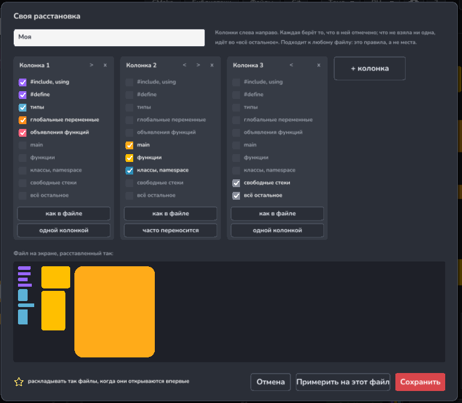

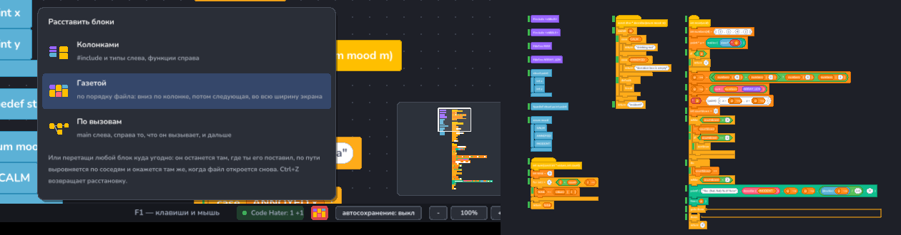

## Building

**Build** (Ctrl+B) builds the project; **Run** in the panel (Ctrl+R)
builds it and starts the program. Before anything, every open file with
changes is saved, and a project with no `CMakeLists.txt` gets one (above).
Then CMake does the work in the background, while the window stays live:

- configure, the first time (`.ccratch/build` in the project: Debug, Ninja
  when it is installed, `compile_commands.json` for other tools), then
  `cmake --build`; later builds only build, and CMake configures again
  by itself when `CMakeLists.txt` changed;
- the log slides up from the bottom, paths short, errors red, warnings
  orange; a second press of Build, or Stop, stops it (and everything it
  started);
- every error and warning that names a place lands on its block: a red or
  orange outline and a badge, the compiler's words under the mouse. GCC
  and Clang (`main.c:12:5: error`), CMake (`CMake Error at
  CMakeLists.txt:8`), and the linker: `undefined reference to 'draw_sky'`
  marks every call to `draw_sky`. A click on the line in the log opens
  the file and glides to the block.

Files are read with the flags the project's own build uses: Ccratch
looks for `compile_commands.json` (in the project, `build/`,
`build/<preset>/`, `.ccratch/build`, `cmake-build-*/`) and takes each
file's `-I`, `-isystem`, `-D` and `-std` from it, a header those of the
nearest file. So a library CMake fetched into `build/_deps` is found,
and its calls read as calls, not errors. No database yet: build once.
A `CMakeLists.txt` in a subfolder belongs to the project above it.

Saving remembers where every block went in the text it wrote, so a line
number from the compiler finds its block even after blocks were moved,
until the next build. Code clang itself could not read stays text, not
blocks, so its error lands on the block around it.

### Debug, Release, Bug hunt

**Settings > Building** picks how the Build button builds, each in its
own folder so switching throws nothing away:

| Mode | What | Folder |
| --- | --- | --- |
| **Debug** | `-g`, no optimisation: quick to build, easy to step through | `.ccratch/build` |
| **Release** | `-O2`: a faster program, a slower build | `.ccratch/build-release` |
| **Bug hunt** | Debug with AddressSanitizer and UBSan | `.ccratch/build-sanitize` |

In **Bug hunt** the program is watched while it runs. A write past the
end of an array, a use after `free`, a leak, a signed overflow: it stops,
and the report lands on the block that did it, like a compiler error.
The first frame of the stack inside the project is the place; UBSan's
`main.c:5:7: runtime error:` is read like GCC's. Needs `libasan` and
`libubsan` (`sudo dnf install libasan libubsan`).

![Bug hunt: a for loop that goes one past the end of a malloc'd array, the a[i] = i block outlined in red, "AddressSanitizer: heap-buffer-overflow" under the mouse](docs/bug_hunt.png)

The bug button always builds something it can debug: in Release it
builds Debug for that run.

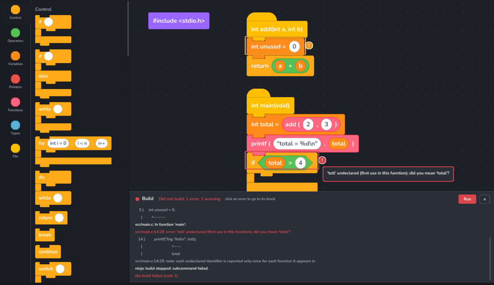

## Debugging

The bug in the top bar (F8) builds the program and runs it under gdb.
Point at a block inside a function and press **F9**: a red dot, a
breakpoint. The program stops there, before that block runs:

- the block gets a yellow outline and an arrow, and a card beside it
  with the values of what it uses (`total = 1`, `i = 2`); a value that
  changed since the last stop is in the accent colour;
- the panel at the bottom has every variable of the function, the call
  stack (a click on a function shows its variables and glides to its
  block), and what the program printed; the program has a terminal of
  its own, so its lines come as it prints them, not when it ends, and a
  prompt (`name? `) shows before its newline;
- a field under the output types to the program: Enter sends the line
  to its `scanf`, **EOF** ends its input (Ctrl+D); what was typed shows
  in the output as `> Ann`;
- **Continue** (F8), **Step** over a block (F10), **Into** the function
  it calls (F11), **Out** of this one (Shift+F11, and what it gave back
  is printed), **Pause** while it runs, **Stop** (Shift+F8);
- a crash stops it too: the block that crashed in red, `SIGSEGV`, and
  the variables as they were (`n = 0x0`);
- stepping past the end of `main` into the C library goes on by itself:
  only the program's own blocks are stopped on.

Breakpoints belong to their blocks: they move with them, and stay from
one run to the next. F9 while it runs sets one at once (or at the next
stop). gdb has to be installed (`sudo apt install gdb`); Ccratch speaks
to it in its machine interface (GDB/MI).

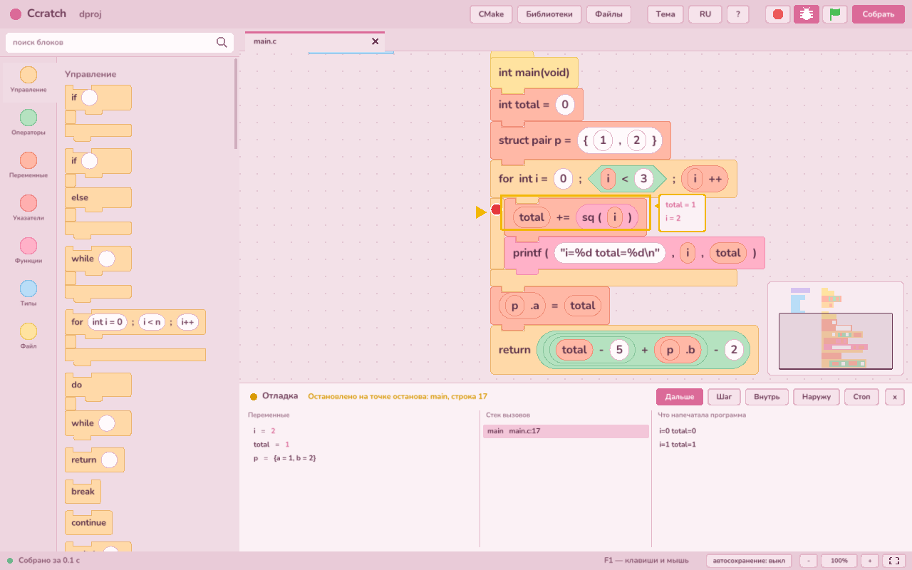

## Git

**Git** in the top bar (Ctrl+G) turns the panel on the right to its Git
tab, as VS Code's Source Control:

- the branch, and **Pull**, **Push** (the number of commits each way on
  them), **Fetch**; they run in the background, and git never sits asking
  for a password nobody sees: it says no, and the panel says why. The
  first push of a branch sets where it goes (`push -u origin`);
- a click on the branch lists the others: a click switches, a name and
  Enter makes a new one. Open files that git changed are read again (the
  ones with unsaved work are left as they are, and it says so);
- the message, and **Commit** (Enter). Nothing staged: everything goes
  in. A tick puts it into the last commit instead (amend). Files with
  changes are saved first: what is on screen is what is committed;
- **Staged** and **Changes**: a file's letter (M, A, D, U), `+` stages,
  `-` unstages, the arrow throws its changes away (a second click is
  asked for: that cannot be undone); all of them at once from the
  header. A click on a file shows its diff over the canvas, with line
  numbers; **Open** opens it as blocks. Each part of the diff has its
  own button: only that part into the index (or out of it), so one
  commit can take half of a file's changes;
- **Stash** beside Commit puts every change aside (new files too) under
  the message, or under the date if there is none; the stash list under
  the changes brings one back (**bring back**) or throws it away (`-`);
- the **History**: the last commits of every branch as a graph, a lane
  per branch, merges joining them, the branches and tags on their
  commits. A click on a commit shows its changes, with **Revert** (a new
  commit that undoes it), **Cherry-pick** (its changes onto this branch)
  and **Branch from here** (a new branch from it);
- in the branch list, **merge in** beside a branch merges it into this
  one. If files conflict, they get their own section: **ours**,
  **theirs** or **both** (ours, then theirs) settles every conflict of a
  file at once (or open it, fix it by hand and `+`), and Commit finishes
  the merge with git's message. A revert or a cherry-pick that conflicts
  waits the same way. **Give up** gives it all up: the files as before.

A tick under the changes shows who last changed each block: a round
badge with the author's initials (each author their own colour) beside
the first block of every run from one commit; a ring for blocks you
changed and have not committed. Rest the mouse on a block and a card
slides out of its badge: who, how long ago and when, the commit's
message. A click on the badge opens that commit.

### Commits made together

A commit several people made names the others at the end of its message,
a `Co-authored-by: Name <mail>` line each (as GitHub and GitLab read
it), and Ccratch shows all of them:

- the badge beside the blocks: the author's face, with the others
  peeking out from behind it;
- the card: everyone's faces in a row (more than four: `+N`), "Ann &
  Bob" or "Ann and 3 more" with every name under the message, and a
  stripe of their colours;
- the history: "Ann & Bob" under the commit; the commit itself: a face
  beside the author and beside each `Co-authored-by:` line.

To make one: **+ co-author** under the message lists everyone who has
committed here (the most frequent first, not you); a tick adds them, and
a field takes someone new, `Name <mail>`, or just a name, or the start
of one, of someone in the list. They sit under the message as chips (x
takes one off) and go into the commit as `Co-authored-by:` lines. After
the commit the next one is yours alone again.

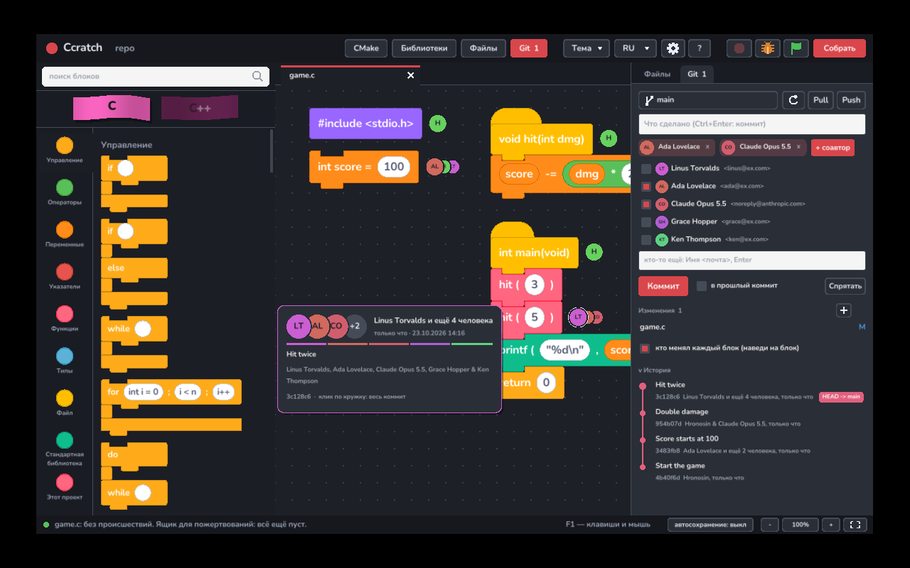

And on the canvas, as in an editor's gutter: a green bar beside a block
that is new since the last commit, blue beside one that changed, a red
wedge where blocks were taken out. They follow every save.

Ccratch's own backups (`FILE~`) go into the repository's local exclude
list, so they are never a change to commit. A project that is not a
repository yet gets a button for `git init`.

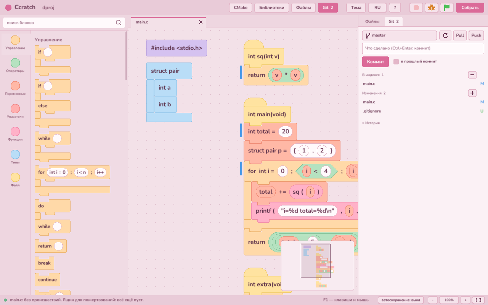

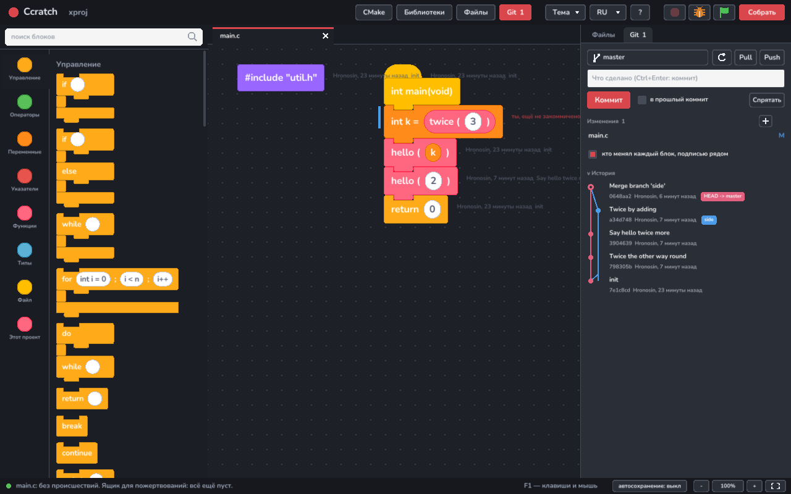

## Expressions

Like Scratch reporters: grab `count` out of `i < count` and it comes out
alone, leaving an empty white slot behind. Drop it into any empty slot
(it lights up yellow), or leave it lying on the canvas for later. Grab the
green `i < count` itself and the whole condition comes, into an `if` from
the palette, say.

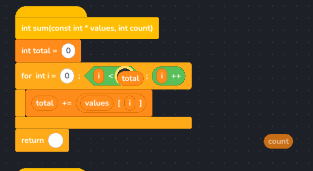

- An empty slot can also be typed into: click it.
- A program with an empty slot is not saved: the status bar says which
  line still has a hole.
- **Delete** and **Duplicate** (pie menu, Del, Ctrl+D) on an expression
  act on that expression: delete leaves its slot empty, the copy follows
  the mouse until a click puts it in a slot.
- Saving rewrites only the slots that changed; the text around them, your
  spacing and comments included, is copied as it was.
- Code a macro made (the `n` inside `TWICE(n)`) does not come apart: the
  whole `TWICE(n)` comes out instead.

How sure is this? The test suite takes every expression of raylib's
sources that may move (about 64 000), and both moves each one into its
own slot and deletes and retypes it: the file has to come back byte for
byte.

## goto arrows

Every `goto` has an arrow to its label, out of its right side and along a
lane to the right of the function. Shorter jumps take the inner lanes, so
the arrows nest like brackets instead of crossing. Put the mouse on a
`goto` or a label and its arrows light up.

Click an arrow to travel along it: the view glides to the other end and a
ring shows where you landed. Which end depends on where you click: the
half by the `goto` takes you to the label, the half by the label brings
you back to the `goto`. The arrow under the mouse marks the end a click
goes to, and a click by mistake in a long file is undone by clicking the
arrow again.

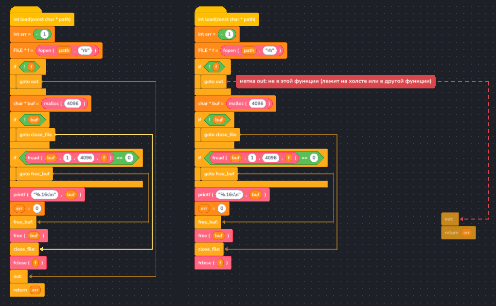

Labels belong to their function. Drag a label out onto the canvas (or into
another function) and the arrow turns red and dashed, and the `goto` says
why; delete it and the `goto` gets a red mark. That is the "use of
undeclared label" clang would tell you about after saving, shown while
you are still holding the block. `examples/goto.c` has the classic kernel
style cleanup ladder to play with.

## Themes

The **Theme** button in the top bar drops a list of them, each with its
colours (the canvas, the accent, the blocks). A click (or the arrow keys
and Enter) takes one and remembers it; Esc or a click outside leaves
everything as it was:

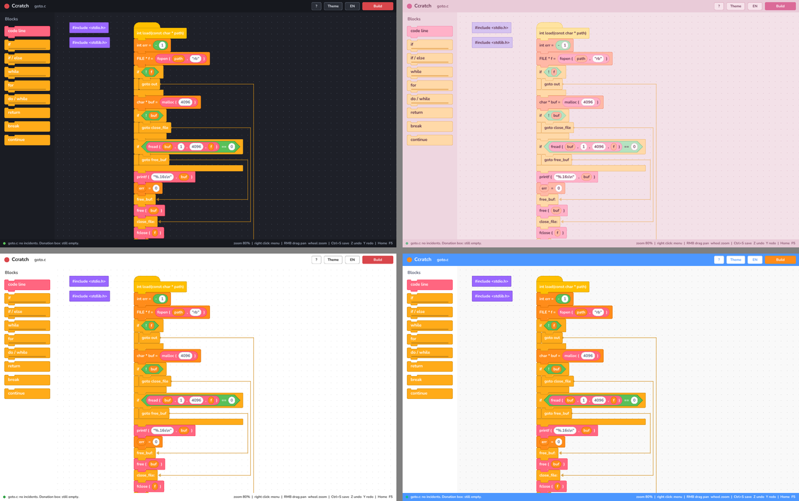

| Theme | What |
| --- | --- |
| **Shrine** | dark, shrine red; built in |
| **Super Serious** | soft pink pastels that do not burn your eyes, deeply serious about it |
| **Masochist** | white. All of it. You asked for this |
| **Scratch** | the editor all of this started from, blue bar and all; pointers are Pen green, dragons are Sound purple |
| **Vim** | a dark terminal and the green of the logo; blocks in the colours `:syntax on` gives C: Statement yellow, Type green, Identifier cyan, PreProc magenta. `:q!` to leave (or pick another theme) |
| **Kernel Space** | the Linux console at boot: black, VGA's sixteen colours, dmesg grey, Tux yellow. Pointers are oops red: in ring 0 nobody catches you |

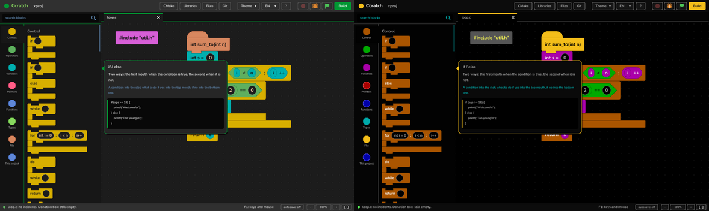

A theme is a text file like a language pack: `themes/NAME.theme`, found
in `$CCRATCH_THEME_DIR`, `~/.local/share/ccratch/themes/` and
`share/ccratch/themes/` next to the program. It sets only the colours it
changes, everything else stays Shrine:

```
@name    = Super Serious
@name.ru = Суровая
bg       = #F3E1E8
control  = #FFD9A8
```

Every key is in `ccratch/src/ccr_theme.h` (or copy one of `themes/`);
`ccratch --check-theme mine.theme` says what is wrong, `--theme NAME`
starts with one, `--list-themes` shows what was found.

## Motion

Blocks are toys, so they move like toys:

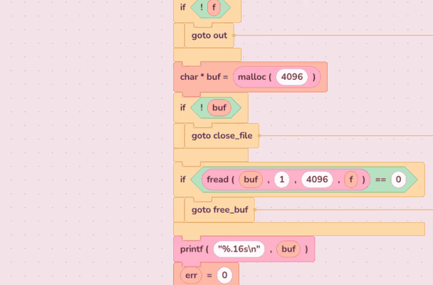

- a stack let go near a snap point glides the last bit into place and
  comes down onto the canvas, its shadow shrinking under it; a ring
  ripples out round it once it is in
- a deleted block goes *poof*, in bits of its own colours
- the pie menu opens like an iris, slices flying out clockwise
- the mouse on a `goto` sends beads running along its arrow, the way the
  jump goes
- Home glides the view back instead of teleporting

None of it waits for you: saving, undoing or grabbing something else
finishes whatever is still moving. **Settings > Look > Animations**, `--no-animations`, or
`animations = off` in `~/.config/ccratch/config`, turns it all off.

## The pie menu

Everything the keyboard does, the mouse does too. Right click (without
dragging: a drag still pans) and a pie opens around the cursor. Each action
always sits in the same direction, so it turns into a flick and a click:

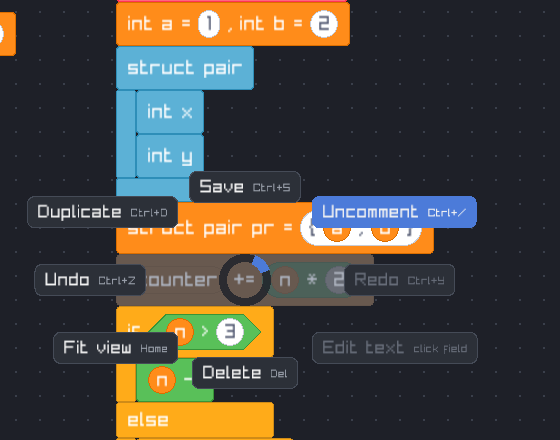

| Direction | Action | Key |
| --- | --- | --- |
| up | Save | Ctrl+S |
| up-right | Comment out / Uncomment | Ctrl+/ |
| right | Redo | Ctrl+Y |
| down-right | Edit text | click a white field |
| down | Delete | Del |
| down-left | Fit view | Home |
| left | Undo | Ctrl+Z |
| up-left | Duplicate | Ctrl+D |

Only the direction counts, not hitting the button: anywhere past the small
ring in the middle picks the slice the mouse points into. Esc, right click
or a click in the ring closes it. Greyed out slices make no sense for what
is under the cursor (nothing to undo, no block there).

The block actions work on the block under the mouse, keys included:

- **Delete** takes out one statement (an `if` goes with everything inside
  it); the rest of the stack closes up. On a loose stack's top block, the
  whole stack goes.
- **Duplicate** makes a copy that follows the mouse, no button held, until
  you click: into a stack, anywhere on the canvas, or onto the palette to
  change your mind. One undo step, copy and drop together.
- **Comment out** turns a statement grey and keeps it in the file as `//`
  lines, its own comments and any blocks inside included. Uncomment
  brings it back exactly as it was:

```c
    // while (b < 10) {
    //     b++;
    //     // nothing else here
    // }
```

## Languages

The interface speaks English (built in), Russian, Ukrainian, Belarusian,
Kazakh, Uzbek, Kyrgyz, Tajik, Azerbaijani, Armenian, Finnish, Japanese,
Chinese (simplified) and Korean, and anyone can add a language without
touching the code: a pack is one text file.

```
@name   = Русский
@plural = slavic

pie.save = Сохранить
status.loaded_errors = %s: %u ошибка ...|%s: %u ошибки ...|%s: %u ошибок ...
```

- The language button in the top bar drops a list of the languages found,
  each in its own words; a click switches and remembers it (in
  `~/.config/ccratch/config`). Otherwise Ccratch starts in the system
  language (`$LANG`), or the one given with `--lang ru` / `$CCRATCH_LANG`.
- Packs are looked for in `$CCRATCH_LANG_DIR`, `~/.local/share/ccratch/lang/`
  and `share/ccratch/lang/` next to the program. The ones in `lang/` here
  are copied there on every build.
- To translate: `ccratch --lang-template > de.lang`, translate the right
  side, then `ccratch --check-lang de.lang` lists what is missing or broken.
- Plurals have a form per case, split by `|`, as many as the language needs
  (`slavic`: 1 ошибка, 2 ошибки, 5 ошибок; `none` for Japanese, Turkic
  languages...).
- Anything a pack leaves out or gets wrong falls back to English. A pack
  cannot crash Ccratch: a translation must use exactly the `%s`/`%u` of the
  English, or it is refused.

### Human language

Under the list, **Human language** says everything without programmers'
words, for people who do not program: Commit is **Save a version**, Push
and Pull are **Upload** and **Download**, a breakpoint is a **stop sign**,
the debugger is **Step by step**, Build is **Make the program**. Every
language above has it. Such a pack is `CODE-plain.lang`, and gives only
what it says differently:

```
@name = Русский, по-человечески
@base = ru
git.commit = Сохранить версию
```

`--lang ru-plain` starts in it; the little dot on the language button says
it is on.

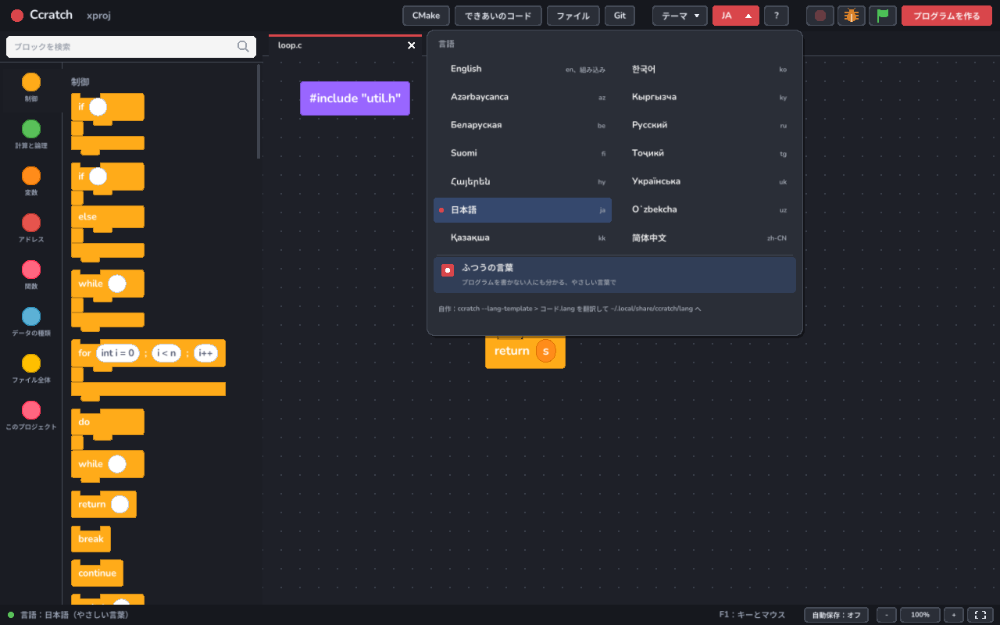

### Letters

Text is drawn with Nunito (SIL Open Font License, `assets/fonts/`), built
into the program with Latin (and its extensions) and Cyrillic, so packs
for most European and Cyrillic languages need nothing more. A pack in
another script names a font with `@font`: Japanese, Chinese, Korean and
Armenian come with Noto Sans (OFL), cut down to the characters the shipped
packs use (`tools/make_font.py`; the test `font_coverage` fails if a pack
gets a character no font draws). A pack of your own can bring its font
as a file next to it: `@font = NotoSansThai.ttf`. Lines of Chinese and
Japanese break between characters, never before 。 or after 「.

C on the blocks (`if`, `while`, `struct`) stays C, and the command line
stays English.

## Files

**Files** in the top bar (or Ctrl+P) slides in the project: every `.c`,
`.h`, `.s` and `.asm` in the folder of the file you opened and the folders under it
(hidden folders, `build/` and the like left out, folders with no code
too). Click a file to open it; the one you were in stays open, with its
undo history, its unsaved changes and where you were looking, and comes
back exactly so. Open files have an × to close them; one with unsaved
changes asks you to click it twice. Ctrl+Tab goes round the open files.

The project is the nearest folder above the file with `.git`,
`CMakeLists.txt`, a `Makefile`, `meson.build` or `compile_commands.json`
in it (else the file's own folder). Its root and its `include/` are
handed to clang, so the project's own headers are found without `-I`.

**+ file** and **+ folder** make new ones in the folder you last clicked
(it is underlined). A file with no extension becomes `.c`. A new header
comes with its guard:

```c
#ifndef VEC_H
#define VEC_H

#endif
```

and a new `vec.c` next to a `vec.h` starts with `#include "vec.h"`. The
new file opens straight away, ready for blocks from **File**.

Click an `#include "..."` block (not its name field, that is for typing)
and the header opens: next to the file, in `../include/`, or anywhere in
the project. `<stdio.h>` and friends are the system's, and stay closed.

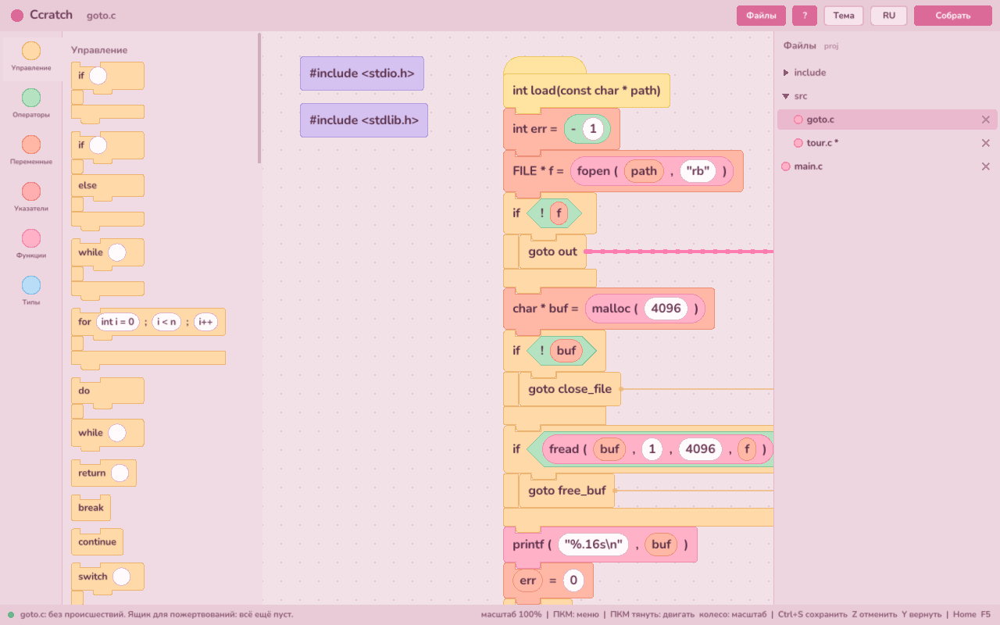

## Saving

Saving splices instead of reprinting: everything you did not touch is
copied from the file byte for byte, so comments, `#ifdef`s, macros and your
formatting stay as they were. Only blocks whose statements moved are put
back together, out of each statement's original text:

- comments right above a statement, and at the end of its line, move with it;
- an empty line above a statement moves with it too;
- a statement keeps any extra indent it had (like inside `rlBegin`/`rlEnd`)
  and is re-indented to its new depth;
- dropping into a braceless `if (x) y;` turns it into `if (x) { ... }`;
- loose blocks on the canvas are left out of the file.

A block with something other than comments between its statements (an
`#if`, a `#define`, code made by a macro) is refused rather than guessed
at: the status bar says which line, and nothing is written.

The first save of a session copies the file as it was opened to `FILE~`,
and the file is written to a temporary name and renamed, so a crash never
leaves half a file. After saving, Ccratch reads the file back with clang and
tells you if your move made code clang rejects (say, a `return` moved out
of its function's type).

How sure is this? `ccratch --roundtrip FILE.c` checks an untouched file
comes back byte for byte, and the test suite forces every block of
raylib's sources (about 2000 of them) to be rebuilt and checks clang reads
the result back into the same tree.


Object-like macros used as values (`NULL`, `true`, `DEG2RAD`) stay one
purple block. Function-like macros (`MAX(a, b)`) are shown expanded,
since their arguments are real code.

`--dump-ast` prints the tree the blocks are built from:

```
$ ccratch --dump-ast examples/tour.c
...
      ├─ Call free  [63:5]
      │  └─ Ref p  [63:10]
      ├─ Goto done  [64:5]
      └─ Label done  [65:1]
```

## Layout

```
app/        ccratch      - the launcher: main() calls ccr_run(), that's it
ccratch/    libccratch   - the whole IDE in one library (modular monolith)
  ccr_ast     own syntax tree: flat node array + string arena, no libclang
  ccr_parse   the only code that knows libclang exists
  ccr_blocks  one script -> blocks: flat display list + snap points
  ccr_editor  scripts on the canvas, drag and drop, edits the tree
  ccr_arrange arrangements of your own: rules for laying out a file's blocks
  ccr_search  text found and replaced in files: code, strings, comments
  ccr_codegen tree -> C: copies untouched text, rebuilds changed blocks
  ccr_template what the palette offers, as syntax trees (no window)
  ccr_palette the palette: categories, real blocks, scrolling
  ccr_files   the project tree, and the files panel
  ccr_lib     block packs: libraries as blocks
  ccr_api     a library's public functions: headers (API) and .so/.a (ELF ABI)
  ccr_cmake   CMake files into the same syntax tree, as blocks
  ccr_asm     assembly (.s, .asm, asm() in C; x86 and ARM) into the same tree, as blocks
  ccr_build   the project as something to build: a first CMakeLists.txt
  ccr_job     the Build button: configure, build, run; output read for errors
  ccr_proc    a program in the background, its output read line by line
  ccr_yaml    the bit of YAML block packs are written in
  ccr_pie     the pie menu: picks an action by direction, knows no editor
  ccr_lang    every text the window shows, and the language packs
  ccr_theme   every colour, and the theme files
  ccr_config  ~/.config/ccratch/config, and where add-ons are found
gui/        libccr_gui   - the only code that knows raylib exists
include/    public headers: ccratch.h, ccr_plugin.h (plugin ABI)
plugins/    each plugin is its own .so: code_hater/, and hello/, the template
examples/   files to feed the parser: C, C++, assembly (hello.s, hello.asm, hello_arm64.s, hello_arm.s, inline.c)
lang/       language packs (ru.lang...); English is built in
blocks/     block packs (raylib.yaml...)
arrangements/ ways to lay out the blocks (kernel.arrange...)
themes/     themes (serious.theme...); Shrine is built in
assets/     icon and font, built into libccratch
tools/      make_font.py: how assets/fonts was made from upstream Nunito
docs/       screenshots
tests/      headless CTest suite
cmake/      dependencies, fetched from git by tag; FindLibClang
```

## Build

### The lazy way

```sh
./run.sh            # builds it if it is not built (or the code changed), then starts it
./run.sh game.c     # ...with a file open
./build.sh          # only build (release; or: debug, paranoid, clean)
./build.sh deps     # install what building needs: dnf, apt, pacman or zypper
```

They find missing tools before anything starts and offer to install
them, start the build again by themselves after the folder was moved, and
can be double-clicked in a file manager: a terminal opens to show the
build (and stays open if it fails), then the window. The build goes to
`build/release`.

On Windows, `run.cmd` and `build.cmd` do the same inside WSL (Ccratch is a
Linux program: it talks to the compiler, gdb and git the Unix way). With
no WSL yet they say how to get it (`wsl --install`); Windows 11 shows the
window like any other. A `.c` file dropped onto `run.cmd` opens.

### By hand

Needs GCC (or Clang), CMake 3.21+, libclang, and the X11/OpenGL dev headers
raylib uses. On Fedora:

```sh
sudo dnf install gcc cmake clang-devel libX11-devel libXrandr-devel \
                 libXinerama-devel libXcursor-devel libXi-devel mesa-libGL-devel
```

If libclang lives somewhere unusual, pass `-DLIBCLANG_ROOT=/path/to/llvm`.

Then:

```sh
cmake --preset debug      # or: release, paranoid
cmake --build --preset debug -j
./build/debug/bin/ccratch
```

Presets use Unix Makefiles. Ninja is not invited.

`paranoid` turns on `-Werror`, AddressSanitizer and UBSan for our code.

Tests run without a window:

```sh
ctest --test-dir build/debug --output-on-failure
```

### If CMake complains about a different directory

`build/` remembers absolute paths. After moving or renaming the project
folder, delete it and configure again:

```sh
rm -rf build && cmake --preset debug
```

### If parsing complains about `stddef.h` or `size_t`

libclang could not find clang's own builtin headers. Ccratch looks for
them at run time next to the libclang it loaded (this covers Fedora, where
libclang is in `/usr/lib64` and the headers in `/usr/lib/clang/N`), then
falls back to the path found at build time. See what it picked:

```sh
ccratch --about
```

Override it with `CCRATCH_CLANG_RESOURCE_DIR=/usr/lib/clang/22`, or per
file with `ccratch file.c -- -resource-dir ...`.

## Command line

```
ccratch                                  open the editor
ccratch file.c                           open a file as blocks
ccratch file.c -- -Iinclude -DDEBUG      extra arguments go to clang
ccratch --dump-ast file.c                print the syntax tree, no window
ccratch --roundtrip file.c               check saving an untouched file is lossless
ccratch file.c --zoom 50                 start zoomed out
ccratch --lang ru                        interface in Russian
ccratch --list-langs                     language packs found, and where
ccratch --lang-template                  English text as a pack to translate
ccratch --check-lang uk.lang             check a pack before sharing it
ccratch file.c --no-animations           blocks just jump into place
ccratch --make-blocks lib.h              a draft block pack for a library
ccratch --make-cmake DIR                 the CMakeLists.txt Ccratch would make for a project
ccratch --check-blocks pack.yaml         check a block pack
ccratch --check-code a.c b.s             what the plugins say about some files
ccratch --list-blocks                    block packs found, and where
```

`--dump-ast` exits with 0 if the file is clean, 1 if it has errors,
2 if clang could not read it at all.

## Settings

The cog in the top bar (or **Ctrl+,**) opens every setting on one card,
in five sections. Every change takes at once and is remembered:

- **Look**: theme and language (click the name for the next one, or the
  arrows), Human language, the interface size (auto, or 75% to 300%),
  animations;
- **Editor**: autosave and how long after a change it waits, the minimap,
  the dots on the canvas, the standard library's blocks, block
  explanations, Git authors beside blocks;
- **Building**: Debug, Release or Bug hunt (above);
- **Plugins**: each plugin's switch, and its own settings under it;
- **Other**: panel sizes back to how they were, forget the recent files,
  the agreement once more. Where the settings file is, at the bottom.

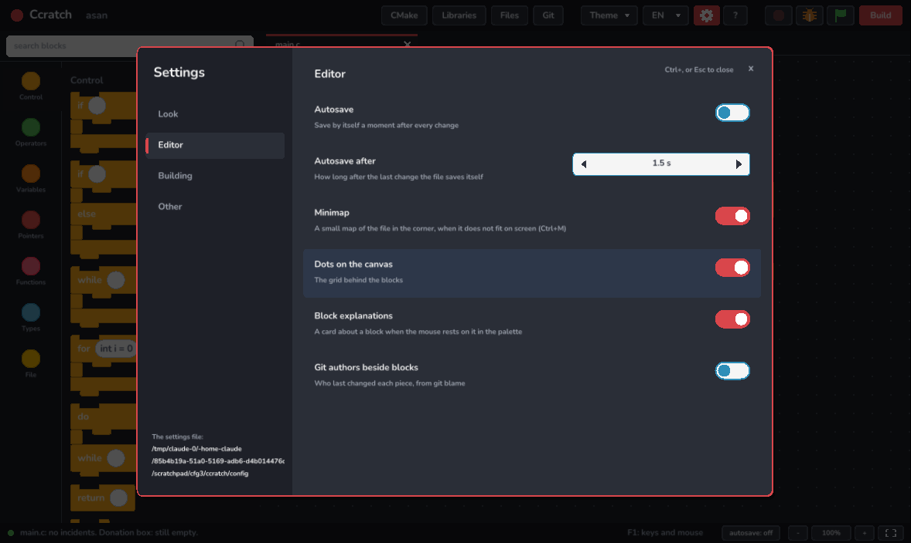

All of it is plain `key = value` lines in `~/.config/ccratch/config`, if
you would rather edit that:

```
theme = vim
lang = ru
lang_plain = yes
ui_scale = auto
animations = on
autosave = on
autosave_delay = 1.5
minimap = on
grid = on
explain = on
palette_std = on
git_authors = off
build_mode = sanitize
plugin.code_hater = on
plugin.code_hater.brutality = mother_cat
plugin.code_hater.nits = off
```

## Plugins

A plugin is a shared library that exports `ccr_plugin_entry()`
(`include/ccratch/ccr_plugin.h`, C ABI: anything that speaks C can write
one. Yes, even Rust. It will regret it). Ccratch loads every `.so` in
`$CCRATCH_PLUGIN_DIR`, `~/.local/share/ccratch/plugins` and
`share/ccratch/plugins` next to the program, and **Settings > Plugins**
lists them with a switch each (`plugin.NAME = off` in the config).

A plugin can have **settings of its own**: switches and choices it lists
in its `ccr_plugin` (`settings`, with the words for each in the
interface's language from `setting_text`). Settings > Plugins shows them
under its switch, the config keeps them as `plugin.NAME.KEY = VALUE`, and
the plugin reads them while it checks (`file->setting(file, "KEY")`).
A checker can also **poke** a node (`file->poke`): when the user saves or
builds, Ccratch flies there and makes a scene of it (below). Both came
later than the first plugins, so a plugin looks at `struct_size` before
using them, and the host does the same with the plugin's: old ones keep
working.

A checker plugin gets the file a moment after every change: the same tree
`--dump-ast` prints, as a flat array of nodes, plus the source. It reports
findings on nodes, and each lands on its block as a badge: **NAK**, **!**,
**nit** or **+1**. The mouse on a badge slides out the plugin's reply; the
status bar counts them, and a click there glides to the next one.

`ccratch --check-code FILE...` prints the same in a terminal (exit 1 on a
warning or worse, so it fits in CI), `--list-plugins` shows what was
found. `plugins/hello/` is the smallest plugin there is: copy it.

### Code Hater

The first official plugin. A borrow checker, but for C, and in a much worse
mood: it reviews your code the way the old mailing lists did, loudly, in
English or Russian. It hates the code, not you. Mostly. Every rant ends
with the fix.


| | What it catches |
| --- | --- |
| **NAK** | `return &local;` and returning a local array; use after `free`; double `free`; `gets()`; `void main`; Rust pushed in a comment or a string ("rewrite it in Rust", "blazingly fast", "TODO: port to Rust"), a name like `unwrap_or` |
| **!** | a `malloc` never freed, returned or stored; `p = realloc(p, n)`; `malloc` used without a NULL check; `strcpy`, `strcat`, `sprintf`; `=` in a condition (unless `((x = f()))`, on purpose); variable-length arrays; `alloca`; `goto` backwards |
| **nit** | four levels of nesting (`else if` chains don't count); functions over 80 lines or with more than 12 locals; `sizeof(int)` where `sizeof *p` would follow the pointer; casting `malloc`'s result; `f()` instead of `f(void)`; `atoi`; Rust only mentioned, nobody pushing it |
| **+1** | a `goto` forward, to cleanup: the kernel way |
| **C++** | raw `new` (a nit: who deletes it?), `using namespace` in a header (a warning); C's nits about `f()` and casting `malloc` stay quiet in C++, where both are right |
| **asm()** | a register the instructions write that is neither an output nor a clobber (NAK: `movl $1, %%ecx` with no `"ecx"`; `rdtsc` and `cpuid` count, they write registers without naming them); a store to memory with no `"memory"` clobber (!); `rdtsc`, `pause`, `cpuid`, `bswap`, `popcnt` where a builtin says the same in C (nit) |
| **ARM** | `bl` in a function that never saved the link register (NAK: its own way back is gone, `ret` loops to after the `bl` forever); `x19`-`x29` or `r4`-`r11` written without saving them (NAK); `sp` not back where it was at `ret` / `bx lr` / `pop {pc}` (NAK, frame pointers and `mov sp, x29` understood); falling off the end, dead code after `b` or `ret`, as for x86 |
| **.s / .asm** | `ret` with the pushes and pops out of step (NAK, following the jumps to see what the stack is at each label); writing `rbx`, `rbp`, `r12`-`r15` without saving them first (NAK: they are the caller's); a function that ends with no `ret` or `jmp` and falls into the next (!); code right after a `jmp` or `ret` that no label leads to (!); `mov $0` where `xor` would do, no `.note.GNU-stack` (nits) |

It looks at what is in the program: loose blocks on the canvas and
commented-out ones are left alone. And it reads context:

- Rust **pushed** ("rewrite it in Rust", "TODO: port this", "memory safe")
  is a NAK; Rust only **mentioned** ("Привет, Rust!") is a nit;
- a string in a table (`{ "...", "..." }`) or one a search looks for
  (`strstr(name, "rust")`) is data, not something the program says, and
  a name that hunts Rust (`is_rust`, `mentions_rust`) is on its side;
- the same thing about the same block is said once, "and 11 more like it
  in this block", not twelve times;
- a statement clang could not read (a type it did not know) has no
  condition to judge, so it does not guess one;
- quotes are shown as written: `«Привет»`, not `\320\237...`;
- and opened on its own source it recognises itself: every "Rust" in
  there is a rant about Rust, so it says "this is me" instead of NAKing
  its own insults (and reviews the rest like anyone else's). The persona is made up; no real person
said any of it, although several would have.

How brutal it is, and what it looks at, are its settings (Settings >
Plugins, under it):

- **How brutal**: *Grumpy* says what is wrong; *Linus on a bad day* says
  it the way the old lists did, an opener before ("Stop. Put the keyboard
  down. Step away from the keyboard.") and a verdict after ("Go read K&R.
  The whole thing. I'll wait."); *Mother cat* (the default) grabs you by
  the scruff ("*drags you across the canvas by the scruff* Here. Right
  here.") and, when you save or build, **rubs your nose in it**: the view
  flies to the block, everything else goes dark, a ginger paw comes in
  from the corner and pushes your face into the bug three times while she
  shouts. The worst three, a few seconds each; a click or Esc and she
  lets go. Autosave does not set her off, only you pressing Ctrl+S or
  Build;
- **Praise**, **Nits**, **Rust patrol**, **Assembly**: each its switch.

Every rant has a few ways to say it, and the tone has dozens more: the
same block always gets the same words (no flicker), two blocks rarely do.


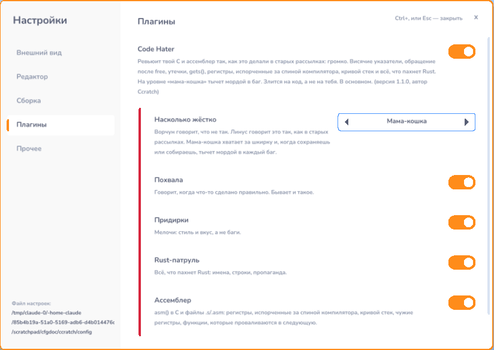

## Interface size

Ccratch was drawn on a 27" 2560x1440 screen. On any other it sizes itself:
the system's scaling if it has one (GNOME, KDE, Windows), else the
screen's pixels an inch, so a 4K monitor or a dense laptop gets bigger
text and buttons, and a small screen a bit smaller ones, never so big the
panels don't fit. Then by hand:

- **Ctrl+Alt+=** / **Ctrl+Alt+-**: bigger or smaller (75% to 300%),
  remembered; **Ctrl+Alt+0**: as the screen wants again;
- `ccratch --ui-scale 150%` (or `1.5`, or `auto`), or `CCRATCH_UI_SCALE`;
- `CCRATCH_UI_SCALE_WHY=1 ccratch` prints what the screen said and what
  was picked.

The canvas zoom (Ctrl+= / -, the wheel) is separate: it sizes the blocks,
this sizes everything.

## Controls

- Drop a `.c` file onto the window: open it
- Left mouse drag: move blocks
- Right click: the pie menu (above)
- Del, Ctrl+D, Ctrl+/: delete, duplicate, comment out the block under the mouse
- Ctrl+S: save (Esc no longer quits, so it cannot eat unsaved work)
- Ctrl+B: build; Ctrl+R: build and run; again while it builds: stop
- F8: debug, continue; F9: breakpoint on the block under the mouse; F10,
  F11, Shift+F11: step, into, out; Shift+F8: stop debugging
- Ctrl+F: find blocks; Enter / F3: next, Shift: back; Esc: close
- Ctrl+Shift+F: search the project; Ctrl+Shift+H: and replace
- Ctrl+= / Ctrl+- / Ctrl+0: zoom in, out, back to 100%
- F1: keys and mouse
- Ctrl+,: settings
- Ctrl+C / Ctrl+V: copy blocks as code, paste code as blocks
- Drag on empty canvas: select; Ctrl+A: all; Del: delete them
- Ctrl+M: minimap
- Ctrl+Z: undo one drag; Ctrl+Y or Ctrl+Shift+Z: redo. Undoing back to
  the saved state clears the `*`, and an undone change is gone from the
  file too: undo everything and the file saves byte for byte as it was
- Right or middle mouse drag: pan the canvas
- Mouse wheel: zoom around the cursor
- Click a goto arrow: travel to its other end
- Click an operator: swap it for another
- Ctrl+P: the files panel; Ctrl+Tab: the next open file
- Ctrl+G: Git: changes, commit, branches, pull and push
- Click an `#include "..."`: open that header
- Double click an `if`, a loop, a function, a struct: fold or unfold it
- Home: back to the start of the file at 100%
- F5: reload the file from disk (throws away unsaved moves; the title shows
  `*` while there are any)

## License

Ccratch is licensed under the **IHATERUSTL** (Insane Harmonic Amazing
Trust Elementary Random United Standardized Temple License), which is
legally the [Mozilla Public License 2.0](LICENSE) wearing a shrine maiden
costume. Fork it and change it: keep the authors, keep your changes to
these files open. Plugins and programs of your own around it can be under
any license. The spirit of the thing, and the third-party licenses, are in
[IHATERUSTL.md](IHATERUSTL.md).

On first run Ccratch also asks you to accept an End User License
Agreement. It is a joke from start to finish and has no legal force;
`ccratch --eula` prints it.
